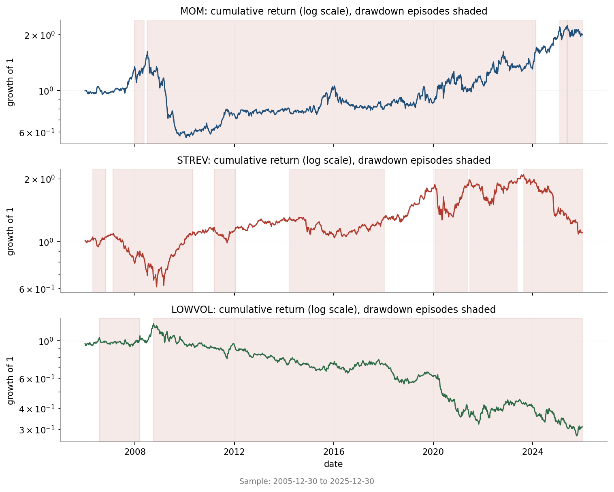
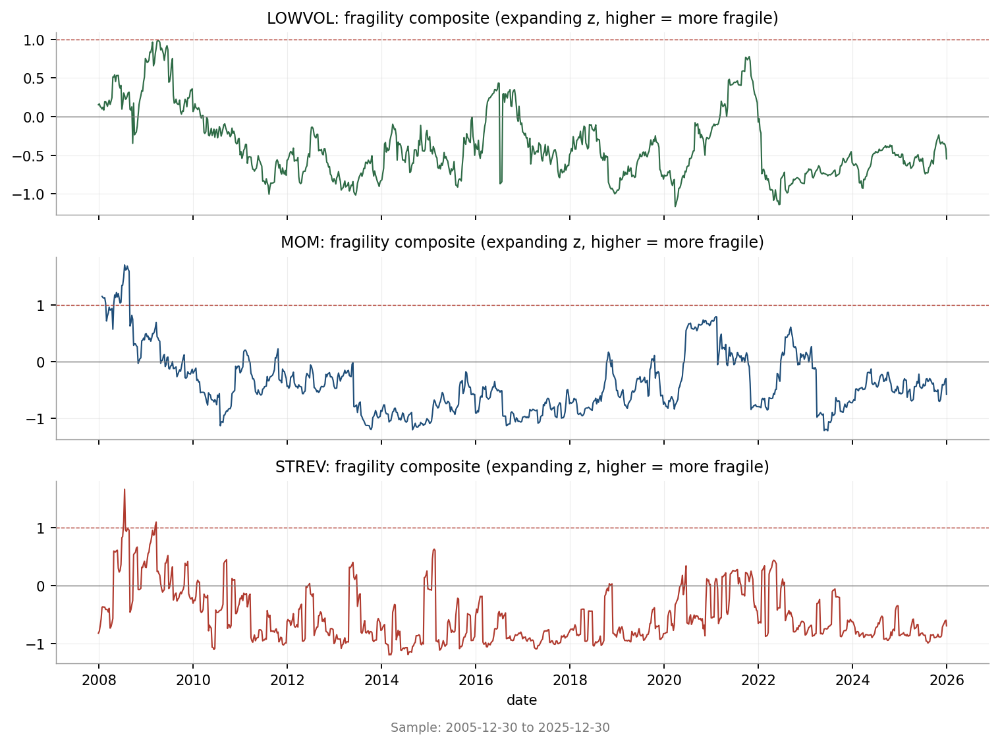
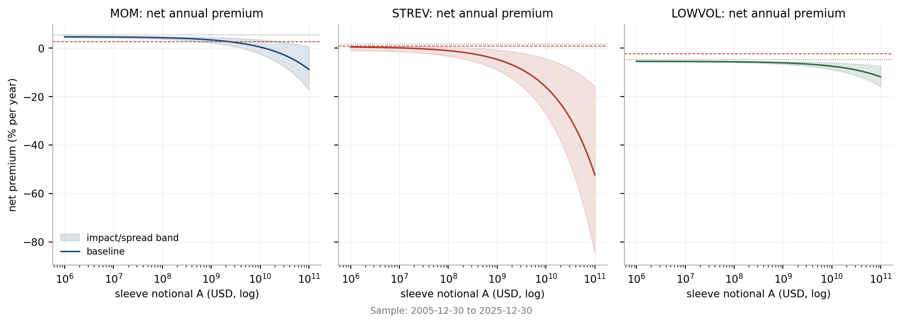
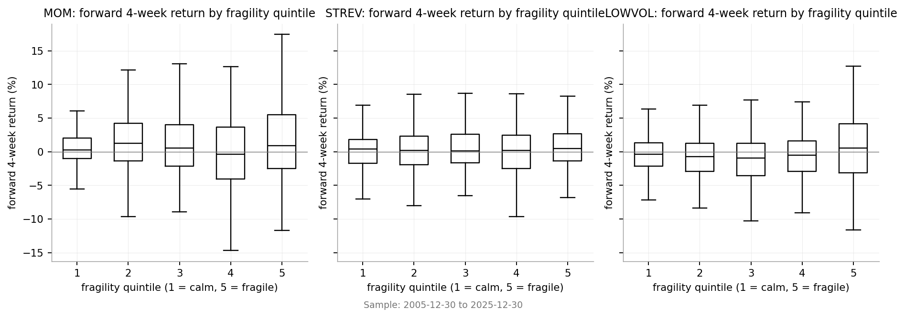
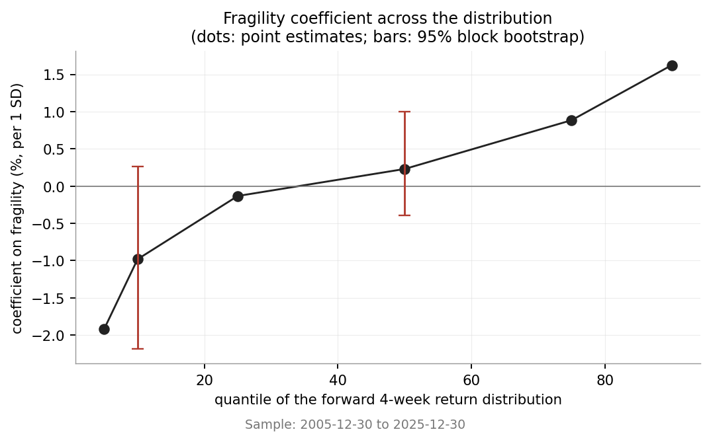
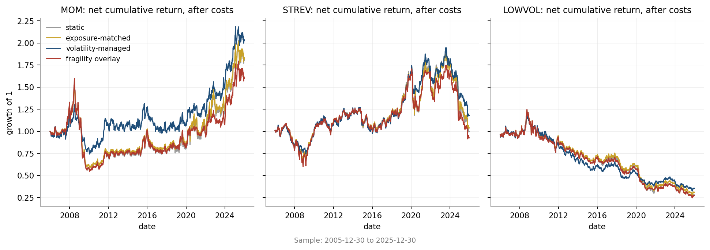

# Crowded Exits: Results

*Generated 2026-11-18 14:19 UTC from run `adda1236ef50_20261118T140421Z`. Every number below is produced by the pipeline.*

## 1. Answer

**No left-tail association was detected at the stated resolution.** The quantile-0.10 coefficient is -0.98% per one standard deviation of fragility (95% CI -2.19% to 0.27%). With this sample the minimum detectable effect is 1.69% of four-week return per standard deviation. Effects smaller than that would not be detected here; this is a statement about resolution, not proof of absence.

**H2 is the more informative result.** The uncontrolled coefficient is -2.38%; with the full control set it is -0.98%. Retention is 0.41, below the stated 0.50 threshold. The fragility composite is largely a volatility proxy; it does not add information beyond volatility at this resolution.

The overlay test is the decisive practical result. Against a volatility-managed portfolio at the same average exposure, the fragility overlay fails the stated H3 rule (0 of 3 factors pass). True expected shortfall differences are reported in Section 8.

Capacity is a model output, not a measurement. At a 100bp annual trading-cost-drag hurdle and a 10-day execution horizon, cost-drag capacity is LOWVOL $2.07B, MOM $395M, STREV $7M. The ordering follows turnover by construction; the level depends on the execution horizon, the impact coefficient, and the data sample. See Section 6.

## 2. Reproduction of the V1 defect

V1 defined `value_score = -momentum_score` and then took the top and bottom quintiles of each. The weight vectors are exact negatives, so the two return series must be exact negatives. Rebuilding them here:

| quantity | value |
| --- | --- |
| months rebuilt | 239 |
| max |w_value + w_momentum| | 0.0000 |
| return correlation | -1.0000 |
| identity holds | 1 |

The recorded F1 of 0.9483 implies a positive-class base rate of 0.902 from the identity `F1 = 2*pi/(1+pi)`. The reported precision and recall also imply a confusion matrix with no true negatives: the model never predicted the rare class. On the rebuilt series in this sample the negative forward three-month rate is 0.647 over 156 weekly observations, so a constant predictor scores 0.7860 here rather than 0.9483. The exact figure depends on V1's data and window, which are not reproducible from this repository. What reproduces is the mechanism: a constant predictor scores at the base rate, and V1's headline number is that score.

## 3. Data and universe

| item | value |
| --- | --- |
| sample | 2005-01-03 to 2025-12-30 |
| daily rows | 5282 |
| tickers with data | 895 |
| rebalance dates | 1045 |
| mean universe size | 498.4890 |
| minimum universe size | 444 |
| tickers with last valid date before 2025-06-01 | 0 |
| equal-weight panel CAGR | 18.14% |

**Survivorship is complete, not residual.** The candidate pool is current S&P 500/400 membership. Every ticker in the panel is still present in 2025; there are no delistings. Factor premia and capacity levels are biased upward and are not investable estimates. This is the binding limitation of the project.

Universe rule: the 500 largest 60-day median dollar volumes among names with 252 days of history and a $5 price floor, recomputed from trailing data at every rebalance. The candidate pool is not point-in-time with respect to existence.

## 4. Factors

| factor | dates | mean_abs_portfolio_beta | max_abs_portfolio_beta | mean_names_long | mean_names_short |
| --- | --- | --- | --- | --- | --- |
| MOM | 240 | 0.1020 | 0.5291 | 49.7917 | 49.7917 |
| STREV | 241 | 0.0521 | 0.2266 | 49.7925 | 49.7925 |
| LOWVOL | 241 | 0.0665 | 0.4037 | 49.7925 | 49.7925 |

Invariants asserted at construction: dollar-neutral, gross exposure 2.0, per-name cap 2% of gross, and pairwise factor correlation below 0.9 in absolute value. The construction is dollar-neutral but not beta-neutral; realized CAPM exposure is reported below.

Realized CAPM exposure versus the equal-weight universe (weekly, HAC standard errors):

| factor | beta | beta_t | alpha | alpha_t | r2 |
| --- | --- | --- | --- | --- | --- |
| MOM | -0.1460 | -3.4400 | 8.22% | 2.0700 | 0.0280 |
| STREV | 0.2250 | 5.9700 | -2.63% | -0.8100 | 0.1050 |
| LOWVOL | -0.0800 | -3.4000 | -3.31% | -1.0500 | 0.0160 |



## 5. Fragility

Four measures, oriented so that higher means more fragile, standardized on expanding windows with a 104-week burn-in and combined with equal weights: residual synchronization (F1), liquidity-weighted effective breadth (F2, sign flipped), exit horizon at 10% participation for a $1bn sleeve (F3), and long-leg holding persistence (F4). Unweighted breadth is retained as a diagnostic but is degenerate for equal-weight legs and is not part of the composite.

| factor | dates | sync_missing | breadth_missing | exit_missing | persist_missing | composite_missing | composite_usable |
| --- | --- | --- | --- | --- | --- | --- | --- |
| LOWVOL | 1045 | 0.0000 | 0.0000 | 0.0000 | 0.0000 | 0.0995 | 941 |
| MOM | 1045 | 0.0038 | 0.0038 | 0.0038 | 0.0038 | 0.1033 | 937 |
| STREV | 1045 | 0.0000 | 0.0000 | 0.0000 | 0.0000 | 0.0995 | 941 |

Spearman correlation of the standardized measures:

| measure | z_o_sync | z_o_breadth | z_o_exit | z_o_persist |
| --- | --- | --- | --- | --- |
| z_o_sync | 1.0000 | 0.1660 | -0.3520 | 0.1070 |
| z_o_breadth | 0.1660 | 1.0000 | 0.0380 | -0.0130 |
| z_o_exit | -0.3520 | 0.0380 | 1.0000 | -0.0200 |
| z_o_persist | 0.1070 | -0.0130 | -0.0200 | 1.0000 |

Correlation of the composite with log realized volatility is 0.408 and with market volatility 0.317. It is not orthogonal to volatility, which is why H2 is the key test.



## 6. Capacity

**Survivorship warning:** these are model calculations on a survivor-only sample. They are not investable capacity estimates. See Section 3.

Gross premium and beta-adjusted alpha, annualized with HAC standard errors. None of the gross premia is precisely estimated; the retention capacity is conditional on this assumption.

| factor | gross_premium | premium_se | premium_low | premium_high | premium_t | capm_alpha | capm_alpha_t |
| --- | --- | --- | --- | --- | --- | --- | --- |
| MOM | 5.41% | 4.24% | -2.90% | 13.71% | 1.2800 | 8.22% | 2.0700 |
| STREV | 1.70% | 3.49% | -5.14% | 8.54% | 0.4900 | -2.63% | -0.8100 |
| LOWVOL | -4.84% | 3.19% | -11.08% | 1.40% | -1.5200 | -3.31% | -1.0500 |

Net annual premium at each sleeve size, using monthly buy-and-hold traded notional, a square-root impact law with c = 0.314, a 3bp half-spread, a 10-day execution horizon, and a 50bp annual borrow cost. Gross premium is shown for reference.

| factor | $10M | $100M | $1B | $5B | $10B | gross_premium_% |
| --- | --- | --- | --- | --- | --- | --- |
| LOWVOL | -5.4800 | -5.6200 | -6.0600 | -6.8500 | -7.4500 | -4.8400 |
| MOM | 4.6200 | 4.3300 | 3.4000 | 1.7300 | 0.4700 | 5.4100 |
| STREV | 0.1200 | -1.0200 | -4.6400 | -11.1800 | -16.0900 | 1.7000 |

Retention of gross premium (n/a when the gross premium is non-positive):

| factor | $10M | $100M | $1B | $5B | $10B |
| --- | --- | --- | --- | --- | --- |
| LOWVOL | n/a | n/a | n/a | n/a | n/a |
| MOM | 85.5000 | 80.1000 | 62.9000 | 32.0000 | 8.7000 |
| STREV | 7.1000 | -60.2000 | -272.9000 | -657.4000 | -945.5000 |

Capacity at each hurdle. `cost_*` columns are the headline, premium-independent definition: the largest sleeve at which annual trading-cost drag stays under that many basis points. `hurdle_*` columns are the retention definition and are undefined for factors with no gross premium. The last two columns span the impact/spread sensitivity grid at 10 days:

| factor | cost_50bp | cost_100bp | cost_200bp | hurdle_0.25 | hurdle_0.50 | hurdle_0.75 | impact_spread_low | impact_spread_high |
| --- | --- | --- | --- | --- | --- | --- | --- | --- |
| LOWVOL | $438M | $2.07B | $8.95B | n/a | n/a | n/a | $539M | $22.63B |
| MOM | $67M | $395M | $1.87B | $6.32B | $2.30B | $269M | $55M | $4.85B |
| STREV | $1M | $7M | $75M | $2M | $1M | $1M | $1M | $235M |

The ordering follows turnover by construction. It is a descriptive identity of the cost model, not a hypothesis test. The interpretable quantity is the level and its sensitivity.

Cost-drag capacity by execution horizon (baseline impact and spread):

| factor | 1 | 5 | 10 | 21 |
| --- | --- | --- | --- | --- |
| LOWVOL | $207M | $1.03B | $2.07B | $4.34B |
| MOM | $39M | $197M | $395M | $829M |
| STREV | $1M | $4M | $7M | $15M |

Premium-retention capacity at the 50% hurdle as a function of the assumed gross premium. The realized premium is a noisy estimate; the capacity level is quadratic in this assumption.

| factor | 1.0% | 2.0% | 3.0% | 5.0% | 7.5% | 10.0% |
| --- | --- | --- | --- | --- | --- | --- |
| LOWVOL | $1M | $438M | $2.07B | $8.95B | $24.34B | $47.27B |
| MOM | $1M | $67M | $395M | $1.87B | $5.24B | $10.31B |
| STREV | $1M | $1M | $7M | $75M | $260M | $557M |



Cost to liquidate the whole position once, held notional:

| factor | $10M | $100M | $1B | $5B | $10B |
| --- | --- | --- | --- | --- | --- |
| LOWVOL | 5.5 | 11.0 | 28.2 | 59.4 | 82.8 |
| MOM | 5.6 | 11.4 | 29.5 | 62.2 | 86.8 |
| STREV | 5.7 | 11.6 | 30.1 | 63.6 | 88.7 |

## 7. Tail study

Sample: 2780 factor-week rows, 928 dates, roughly 232 independent four-week blocks, 2007-12-28 to 2025-10-03.

Primary specification, pooled with factor fixed effects and volatility, trend, and liquidity controls. Standard errors and intervals from a stationary bootstrap with mean block 8 and 2000 replications. Duplicate dates are retained.

| quantile | term | estimate | se | ci_low | ci_high | negative_share |
| --- | --- | --- | --- | --- | --- | --- |
| 0.1000 | composite | -0.9820 | 0.6050 | -2.1850 | 0.2650 | 0.9350 |
| 0.1000 | log_vol | -2.3570 | 0.4430 | -3.0260 | -1.2830 | 1.0000 |
| 0.1000 | mkt_vol | -0.8840 | 0.4590 | -1.7870 | 0.0030 | 0.9740 |
| 0.1000 | trail_12w | -9.3570 | 3.2150 | -14.6220 | -2.2760 | 0.9940 |
| 0.1000 | liq_regime | -1.1060 | 2.4270 | -5.5840 | 3.9030 | 0.6710 |
| 0.5000 | composite | 0.2300 | 0.3510 | -0.3910 | 1.0000 | 0.2120 |
| 0.5000 | log_vol | -0.4050 | 0.2710 | -0.8900 | 0.1810 | 0.9050 |
| 0.5000 | mkt_vol | -0.0470 | 0.2030 | -0.4860 | 0.2930 | 0.6060 |
| 0.5000 | trail_12w | -2.8730 | 1.5820 | -6.4300 | -0.1890 | 0.9830 |
| 0.5000 | liq_regime | -0.1000 | 1.0870 | -1.8820 | 2.4780 | 0.4240 |

Minimum detectable effect at 5% significance and 80% power: **1.69% of four-week return per one standard deviation of fragility** (0.364 standard deviations of the return distribution). The tail-specificity difference between the 0.10 and 0.50 coefficients is -1.21% with a 95% interval of (-2.42%, -0.12%).

**H2: does the association survive controls?**

| specification | estimate | retention |
| --- | --- | --- |
| uncontrolled | -2.3790 | n/a |
| full_controls | -0.9820 | 0.4130 |
| log_vol_only | -1.1460 | 0.4820 |

Per-factor estimates at the 0.10 quantile (exploratory):

| factor | estimate | se | ci_low | ci_high | pvalue | n |
| --- | --- | --- | --- | --- | --- | --- |
| LOWVOL | 0.3300 | 0.9510 | -1.8350 | 1.8970 | 0.7780 | 928 |
| MOM | -2.4900 | 1.0910 | -4.4150 | -0.1300 | 0.0280 | 924 |
| STREV | -1.0170 | 1.1490 | -3.2230 | 1.4370 | 0.3750 | 928 |

**Quintile sort (assumption-light check): fragile minus calm mean return.**

| factor | q5_minus_q1 | ci_low | ci_high | n_q5 | n_q1 |
| --- | --- | --- | --- | --- | --- |
| LOWVOL | 0.9970 | -0.9530 | 4.3520 | 67 | 306 |
| MOM | 0.8950 | -1.0290 | 2.8110 | 106 | 214 |
| STREV | 0.9680 | -0.5970 | 2.5290 | 82 | 222 |

**Subsample stability (pooled 0.10 coefficient).**

| period | estimate | ci_low | ci_high | n |
| --- | --- | --- | --- | --- |
| 2005-2009 | -1.7890 | -6.2560 | 1.7110 | 314 |
| 2010-2017 | 1.0190 | -0.0840 | 1.8390 | 1251 |
| 2018-2025 | -1.2010 | -2.6780 | 0.1420 | 1215 |

**Non-overlapping check:** the same specification on every fourth week, so the four-week target windows do not overlap.

| specification | estimate | se | ci_low | ci_high | n_dates | n_rows |
| --- | --- | --- | --- | --- | --- | --- |
| every_fourth_week | -1.0060 | 1.1080 | -3.6090 | 0.9190 | 232 | 695 |

Individual measures, Benjamini-Hochberg adjusted across the pre-specified family of four measures and two horizons. P-values are centered bootstrap p-values.

| horizon | measure | estimate | se | ci_low | ci_high | pvalue | n | pvalue_adj | reject |
| --- | --- | --- | --- | --- | --- | --- | --- | --- | --- |
| 4w | sync | -0.0190 | 0.2150 | -0.4290 | 0.3700 | 0.9300 | 2780 | 0.9300 | 0 |
| 4w | breadth | -0.8240 | 0.4920 | -1.6480 | 0.2020 | 0.0750 | 2780 | 0.3000 | 0 |
| 4w | exit | -0.8280 | 0.7290 | -2.3310 | 0.6190 | 0.2500 | 2780 | 0.5000 | 0 |
| 4w | persist | 0.1540 | 0.3850 | -0.6860 | 0.7550 | 0.7350 | 2780 | 0.9800 | 0 |
| 13w | sync | -0.1190 | 0.6010 | -1.2880 | 1.0760 | 0.8450 | 2780 | 0.9660 | 0 |
| 13w | breadth | -2.1300 | 0.8770 | -3.7870 | -0.4260 | 0.0050 | 2780 | 0.0400 | 1 |
| 13w | exit | -2.1280 | 1.6790 | -5.2800 | 0.9740 | 0.2450 | 2780 | 0.6530 | 0 |
| 13w | persist | 0.7720 | 0.7130 | -0.7340 | 2.0990 | 0.2700 | 2780 | 0.4320 | 0 |

**E2: expected shortfall difference, fragile minus calm quintile.**

| factor | es_high | es_low | difference | ci_low | ci_high | n_high | n_low |
| --- | --- | --- | --- | --- | --- | --- | --- |
| LOWVOL | -10.5570 | -9.0070 | -1.5500 | -4.9320 | 4.5840 | 67 | 306 |
| MOM | -12.2770 | -6.3710 | -5.9060 | -8.4680 | -0.7330 | 106 | 214 |
| STREV | -8.6490 | -7.5570 | -1.0920 | -6.6570 | 3.9830 | 82 | 222 |
| POOLED | -11.5070 | -7.9540 | -3.5520 | -5.7480 | 0.4410 | 255 | 742 |

Expected shortfall by fragility quintile (percent):

| factor | quintile | mean_fwd_4w | es_5 | share_negative | n |
| --- | --- | --- | --- | --- | --- |
| LOWVOL | 1 | -0.4210 | -9.0070 | 0.5560 | 306 |
| LOWVOL | 2 | -0.7750 | -6.8450 | 0.6060 | 203 |
| LOWVOL | 3 | -0.7600 | -8.5610 | 0.6240 | 178 |
| LOWVOL | 4 | -0.7120 | -9.3310 | 0.5570 | 70 |
| LOWVOL | 5 | 0.5760 | -10.5570 | 0.4630 | 67 |
| MOM | 1 | 0.2180 | -6.3710 | 0.4490 | 214 |
| MOM | 2 | 1.4270 | -8.0660 | 0.3740 | 230 |
| MOM | 3 | 1.0640 | -8.5720 | 0.4640 | 181 |
| MOM | 4 | -0.7470 | -13.6090 | 0.5390 | 89 |
| MOM | 5 | 1.1140 | -12.2770 | 0.4340 | 106 |
| STREV | 1 | 0.0310 | -7.5570 | 0.4140 | 222 |
| STREV | 2 | 0.0780 | -9.4000 | 0.4760 | 250 |
| STREV | 3 | 0.3860 | -9.7560 | 0.4680 | 171 |
| STREV | 4 | -0.2850 | -13.8820 | 0.4750 | 99 |
| STREV | 5 | 0.9980 | -8.6490 | 0.4150 | 82 |

**Composite sensitivity: alternative weightings.**

| variant | estimate | se | ci_low | ci_high | n |
| --- | --- | --- | --- | --- | --- |
| equal | -0.9820 | 0.5410 | -2.0200 | 0.2120 | 2780 |
| drop_sync | -1.1080 | 0.7240 | -2.7720 | 0.3330 | 2780 |
| drop_breadth | -0.3370 | 0.4660 | -1.2320 | 0.4490 | 2780 |
| drop_exit | -0.4870 | 0.3780 | -1.0750 | 0.4230 | 2780 |
| drop_persist | -0.9200 | 0.5490 | -2.2570 | 0.0050 | 2780 |
| rank_average | -2.3720 | 1.5430 | -5.1630 | 0.6540 | 2624 |

Placebo: the composite is block-shuffled within factor and the primary model refit.

| factor | placebo_mean | placebo_sd | real_estimate | pvalue | n |
| --- | --- | --- | --- | --- | --- |
| LOWVOL | -0.0210 | 0.6340 | 0.3300 | 0.5800 | 200 |
| MOM | -0.0720 | 0.9170 | -2.4900 | 0.0050 | 200 |
| STREV | 0.0210 | 0.8010 | -1.0170 | 0.2000 | 200 |





## 8. Decision layer

All strategies pay a 5bp scaling cost on changes in exposure, earn the T-bill rate on uninvested cash, and pay 50bp annual borrow on short notional. The volatility-managed comparator is rescaled so its average exposure equals the overlay's. The factor's own rebalancing cost is not charged here; capacity reports it separately.

**MOM**

| strategy | es_5 | es_10 | q5 | max_drawdown | sharpe | sortino | annual_vol | avg_exposure | turnover_annual | cost_drag_annual | borrow_drag_annual |
| --- | --- | --- | --- | --- | --- | --- | --- | --- | --- | --- | --- |
| static | -0.0660 | -0.0510 | -0.0425 | -0.6578 | 0.2485 | 0.3309 | 0.1972 | 1.0000 | 0.0000 | 0.0000 | 0.0050 |
| exposure_matched | -0.0607 | -0.0468 | -0.0391 | -0.6251 | 0.2557 | 0.3404 | 0.1814 | 0.9200 | 0.0000 | 0.0000 | 0.0046 |
| vol_managed | -0.0462 | -0.0370 | -0.0326 | -0.4294 | 0.3084 | 0.4513 | 0.1509 | 0.9200 | 3.1100 | 0.0016 | 0.0046 |
| fragility | -0.0585 | -0.0451 | -0.0384 | -0.6578 | 0.2224 | 0.2959 | 0.1734 | 0.9200 | 0.7300 | 0.0004 | 0.0046 |

**STREV**

| strategy | es_5 | es_10 | q5 | max_drawdown | sharpe | sortino | annual_vol | avg_exposure | turnover_annual | cost_drag_annual | borrow_drag_annual |
| --- | --- | --- | --- | --- | --- | --- | --- | --- | --- | --- | --- |
| static | -0.0504 | -0.0385 | -0.0322 | -0.4842 | 0.0771 | 0.1083 | 0.1555 | 1.0000 | 0.0000 | 0.0000 | 0.0050 |
| exposure_matched | -0.0468 | -0.0357 | -0.0299 | -0.4545 | 0.0850 | 0.1193 | 0.1446 | 0.9300 | 0.0000 | 0.0000 | 0.0046 |
| vol_managed | -0.0362 | -0.0283 | -0.0237 | -0.3999 | 0.1285 | 0.1849 | 0.1176 | 0.9300 | 3.3300 | 0.0017 | 0.0046 |
| fragility | -0.0462 | -0.0349 | -0.0286 | -0.4771 | 0.0425 | 0.0574 | 0.1395 | 0.9300 | 1.1600 | 0.0006 | 0.0046 |

**LOWVOL**

| strategy | es_5 | es_10 | q5 | max_drawdown | sharpe | sortino | annual_vol | avg_exposure | turnover_annual | cost_drag_annual | borrow_drag_annual |
| --- | --- | --- | --- | --- | --- | --- | --- | --- | --- | --- | --- |
| static | -0.0414 | -0.0345 | -0.0315 | -0.8009 | -0.3788 | -0.6086 | 0.1408 | 1.0000 | 0.0000 | 0.0000 | 0.0050 |
| exposure_matched | -0.0390 | -0.0325 | -0.0297 | -0.7765 | -0.3717 | -0.5972 | 0.1327 | 0.9420 | 0.0000 | 0.0000 | 0.0047 |
| vol_managed | -0.0332 | -0.0278 | -0.0254 | -0.7278 | -0.3920 | -0.6571 | 0.1147 | 0.9420 | 3.2300 | 0.0016 | 0.0047 |
| fragility | -0.0396 | -0.0327 | -0.0293 | -0.8015 | -0.4236 | -0.6604 | 0.1315 | 0.9420 | 0.5700 | 0.0003 | 0.0047 |

Fragility overlay minus volatility-managed comparator, block bootstrap. Positive means the overlay has a better (less negative) tail metric:

| factor | metric | difference | ci_low | ci_high | improves |
| --- | --- | --- | --- | --- | --- |
| MOM | es_5 | -1.2020 | -2.0370 | -0.3670 | 0 |
| MOM | max_drawdown | -13.3320 | -29.0730 | 2.0030 | 0 |
| STREV | es_5 | -0.9760 | -1.7030 | -0.2910 | 0 |
| STREV | max_drawdown | -10.9590 | -24.3700 | 1.0330 | 0 |
| LOWVOL | es_5 | -0.6240 | -1.1160 | -0.1690 | 0 |
| LOWVOL | max_drawdown | -6.6510 | -19.7320 | 3.4820 | 0 |

Random-overlay distribution: the same exposure path distribution, block-shuffled. The percentile rank is the share of random paths with a worse (more negative) true ES than the fragility overlay.

| factor | actual_es_5 | es_5_p05 | es_5_p50 | es_5_p95 | percentile_rank | sharpe_p50 | n |
| --- | --- | --- | --- | --- | --- | --- | --- |
| MOM | -5.8470 | -6.5420 | -6.2830 | -5.9370 | 0.9750 | 0.2430 | 200 |
| STREV | -4.6230 | -4.9920 | -4.8700 | -4.5840 | 0.9050 | 0.0710 | 200 |
| LOWVOL | -3.9560 | -4.1250 | -4.0430 | -3.8880 | 0.8550 | -0.3690 | 200 |



## 9. Limitations

- Survivorship is complete: zero delistings in the panel. Factor premia and capacity levels are biased upward and are not investable estimates.
- No holdings or flow data: fragility measures the portfolio the factor implies, not what other managers actually own.
- The impact coefficient and execution horizon are assumptions, not measurements. Capacity is a model output with a sensitivity band.
- The factors are dollar-neutral but not beta-neutral; realized CAPM exposure is reported in Section 4.
- The study is in-sample. The construction was revised after inspecting results; see the trial ledger and the researcher-degrees-of-freedom section.
- Tail tests are low-powered: the independent units are four-week blocks, not rows.
- Three factors in one market. Results do not generalize to the factor zoo or to other markets.
- The estimand is associational. No causal claim is made about crowding.

## 10. Researcher degrees of freedom

The final specification was not frozen before the results were seen. The factor set, rebalancing frequency, turnover bands, execution horizon, capacity definition, and overlay schedule were revised during implementation (ADR-0005 and ADR-0007). Seven factor candidates and at least 48 overlay configurations were evaluated. The study is therefore **exploratory**, not confirmatory. `docs/trial_ledger.md` records the specifications tried. A genuine holdout is future work.

## 11. What would change the conclusion

- A point-in-time dataset with delistings showing materially lower factor premia and capacity.
- A pre-registered holdout with a negative fragility coefficient whose interval excludes zero, or an overlay that beats volatility management on true expected shortfall.
- A multi-factor risk model showing that residual synchronization is sector or risk exposure rather than crowding.
- A composite weighting that retains a negative coefficient after the drop-one, rank, and PCA checks and survives the quintile sort.
- An execution-calibrated impact model with a materially different coefficient or horizon.

## 12. Reproducibility

```json
{
  "run_id": "adda1236ef50_20261118T140421Z",
  "created_utc": "2026-11-18T14:19:06.327234+00:00",
  "config_hash": "adda1236ef50",
  "git_commit": "9bed1bc",
  "git_dirty": false,
  "versions": {
    "python": "3.10.0",
    "numpy": "1.26.4",
    "pandas": "2.3.0",
    "scipy": "1.15.3",
    "sklearn": "1.7.2",
    "statsmodels": "0.15.0",
    "matplotlib": "3.10.7",
    "yfinance": "1.7.0"
  },
  "panel": {
    "sha256": "7750ef8eeb2f78496f785e537642f6efc89c4e25e0eed9b9a0395b57c69132ba",
    "rows": 5282,
    "tickers": 895,
    "start": "2005-01-03",
    "end": "2025-12-30"
  },
  "universe": {
    "dates": 1045,
    "mean_size": 498.488995215311,
    "min_size": 444
  },
  "rows": {
    "factors": 1045,
    "fragility_composite": 941,
    "study": 2780
  },
  "elapsed_seconds": 885.6,
  "repro_passes": true
}
```

Config hash: `adda1236ef50`. Data SHA256: `7750ef8eeb2f78496f785e537642f6efc89c4e25e0eed9b9a0395b57c69132ba`. The full config is in the run manifest.
